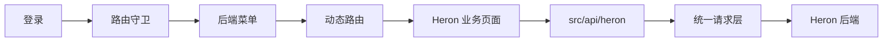

# Heron Console

> Heron 的内容生产、审核、发布与原型交付控制台。

Heron Console 是 [Heron 后端](https://github.com/zhoupei6251/heron) 的配套前端，基于 plus-ui 6.1.0 构建。它保留若依的登录、角色、菜单、审计、监控和工作流能力，同时提供新闻视频生产线和原型工坊的完整操作界面。

本文以当前源码为准。业务菜单由后端动态下发，页面能否访问取决于菜单种子、角色和按钮权限。

## 业务页面

| 业务域 | 主要页面 | 源码位置 |
| --- | --- | --- |
| 选题与来源 | 选题雷达、选题详情、新闻来源、NewsNow 平台目录 | `src/views/heron/news/topic`、`src/views/heron/news/source` |
| 编辑与作品 | 编辑策划、视频作品、作品工作室、分镜与稿件 | `src/views/heron/editorial`、`src/views/heron/news/work` |
| 生产与审片 | 生产任务、能力检查、审片队列、质量报告、抽帧回看 | `src/views/heron/production`、`src/views/heron/review` |
| 发布与表现 | 发布记录、发布尝试核对、内容表现、反馈与建议 | `src/views/heron/publish`、`src/views/heron/analytics` |
| 生产资料 | 数据集、视频模板 | `src/views/heron/asset/dataset`、`src/views/heron/asset/template` |
| 原型工坊 | 原型项目、版本、审核、原生验证与交付 | `src/views/heron/proto` |
| 研究与决策 | 研究任务、内容决策、策略假设与成本 | `src/views/heron/research`、`src/views/heron/decision` |

新闻线覆盖“热点 → 候选 → 认领 → 写稿 → 生成 → 审片 → 确认 → 发布回执”的操作链路。原型线覆盖“需求 → 生成 → 审核 → Axure 原生验证 → 交付”的版本流程。

## 技术栈

| 领域 | 当前实现 |
| --- | --- |
| 框架 | Vue 3.5、TypeScript 6、Vite 8 |
| UI | Element Plus 2.14、Vxe Table、ECharts 6 |
| 状态与路由 | Pinia 4、Vue Router 5 |
| 样式 | UnoCSS 66、Sass |
| 请求与加密 | Axios、AES / RSA 接口加密 |
| 工程工具 | pnpm 10.34.5、oxlint、oxfmt、vue-tsc |

Node.js 支持 `22.12+`、`24+` 和 `26+`。仓库使用 pnpm，并固定了包管理器版本。

## 应用结构



- `src/router` 只注册登录、首页、个人中心等公共路由。
- `src/store/modules/permission.ts` 把后端菜单转成动态路由，并按角色、权限过滤。
- `src/api/heron` 按业务域组织接口与类型，多数模块采用 `index.ts + types.ts`。
- `src/utils/request.ts` 统一处理 Token、客户端标识、防重复提交、接口加解密和错误提示。
- `src/layout` 提供侧边栏、顶部导航、TagsView、设置抽屉、移动端适配和 Heron 健康条。

## 快速开始

### 环境要求

- Node.js 22.12+、24+ 或 26+
- pnpm 10+
- 可访问的 Heron 后端，默认开发端口 `8085`

### 1. 安装依赖

```bash
pnpm install --frozen-lockfile
```

### 2. 配置后端代理

开发环境默认把 `/dev-api` 转发到 `http://localhost:8085`。后端地址不同，可在 `.env.development.local` 中覆盖：

```dotenv
VITE_APP_PROXY_TARGET=http://localhost:8085
```

`*.local` 已被 Git 忽略。前后端的 `VITE_APP_ENCRYPT` / `api-decrypt.enabled` 和 RSA 密钥必须配套，否则登录后的请求无法正常解密。

### 3. 启动开发服务

```bash
pnpm dev
```

默认访问地址为 `http://localhost:80`。端口被占用时，修改 `.env.development` 中的 `VITE_APP_PORT`。

### 4. 登录与菜单

先在后端准备账号、角色和 Heron 菜单种子。登录成功后，前端会请求用户信息和 `/system/menu/getRouters`，再注册当前账号可见的业务页面。仅启动前端不会自动补齐菜单或权限。

## 常用命令

| 命令 | 用途 |
| --- | --- |
| `pnpm dev` | 启动开发服务 |
| `pnpm exec vue-tsc --noEmit` | TypeScript 与 Vue 类型检查 |
| `pnpm lint` | 对 `src` 执行 oxlint |
| `pnpm lint:fix` | 自动修复可修复的 lint 问题 |
| `pnpm fmt` | 使用 oxfmt 格式化仓库 |
| `pnpm build` | 生产构建 |
| `pnpm build:dev` | 开发环境构建 |
| `pnpm build:prod` | 生产构建，与 `pnpm build` 等价 |
| `pnpm preview` | 预览构建产物 |

生产环境 API 前缀为 `/prod-api`，需要由 Nginx 或网关转发到后端。`VITE_APP_CONTEXT_PATH` 决定部署子路径，例如 `/admin/`。

## 目录结构

```text
heron-ui/
├── src/
│   ├── api/heron/                  # 业务接口与类型
│   ├── views/heron/                # 新闻、生产、审片、发布、原型、研究等页面
│   ├── components/                 # 公共组件与 Heron 健康条
│   ├── hooks/                      # loading、表单、搜索、表格选择等 hooks
│   ├── layout/                     # 布局、导航、TagsView、设置抽屉
│   ├── router/                     # 公共路由
│   ├── store/                      # Pinia 状态与动态权限
│   ├── utils/request.ts            # 统一请求、Token、加密与错误处理
│   ├── types/                      # 全局类型扩展
│   └── assets/styles/              # 主题、页面壳与公共样式
├── gen/                            # 代码生成模板，只作骨架
├── vite.config.ts                  # 开发服务、代理与构建配置
├── .env.development                # 开发环境变量
├── .env.production                 # 生产环境变量
└── package.json                    # 脚本、依赖与 Node/pnpm 要求
```

## 开发约定

- 页面使用 `<script setup name="Xxx" lang="ts">`，保持 UTF-8、LF、2 空格缩进。
- 新业务页通常同时维护 `src/api/<module>/<business>/index.ts`、`types.ts` 和 `src/views/<module>/<business>/index.vue`。
- 请求统一走 `@/utils/request`；下载复用 `download`；`AxiosPromise` 从 `@/utils/api-types` 引入，分页类型从 `@/api/types` 引入。
- 查询、表单、弹窗、日期范围、表格选择优先复用 `src/hooks` 中的现有能力。
- 按钮权限使用 `v-hasPermi` 或现有权限工具；页面权限由后端菜单和角色共同决定。
- 标准页面复用 `search-panel`、`table-panel`、`toolbar-shell`、`data-table`、`right-toolbar`、`pagination` 和 `app-container`。
- 复杂页面做增量修改，不退回生成器裸模板，也不为单页需求改全局组件样式。

## 基座能力

- Sa-Token 登录态与路由守卫
- 后端菜单驱动的动态路由和按钮权限
- 角色、部门、岗位、字典、参数、通知、日志等系统管理
- 文件与 OSS 配置、在线用户、定时任务、代码生成
- Spring Boot Admin、SnailJob、工作流等基座入口
- SSE / WebSocket 消息推送
- 主题色、深浅侧边栏、深色模式、多种导航布局、TagsView 和移动端适配

## 当前边界

- 页面和 API 已存在，不代表后端生产流水线、采集白名单或发布凭据已经开启。
- 新闻发布默认使用 `sandbox` 回执；切换到 `douyin-cli` 需要本机命令和账号，作品链接可能需要人工补录。
- 内容表现依赖人工回填或平台凭据；样本不足时页面不输出方向性结论。
- 原型生成成功后仍必须经过人工审核和 Axure 原生验证，系统不把“生成成功”等同于“可交付”。
- 审片页对缺失或损坏产物显示受限状态，不用占位内容冒充真实结果。
- 产品是单租户自部署，不包含多租户、套餐、计费或第二套 RBAC。

## 验证

修改 TypeScript、Vue、API 或类型后，至少运行：

```bash
pnpm exec vue-tsc --noEmit
pnpm lint
```

修改公共 hooks、组件、布局或构建配置后，再运行：

```bash
pnpm build
```

只改文档时不需要启动应用或执行全量构建，但应检查文档中的路径、命令和链接。

## 文档与许可

- [Heron 后端](https://github.com/zhoupei6251/heron)
- [业务规格](https://github.com/zhoupei6251/heron/blob/dev/docs/plans/2026-10-29-heron-business-spec.md)
- [项目开发约定](CLAUDE.md)
- [plus-ui 官方文档](https://plus-doc.dromara.org/)

Heron Console 沿用 MIT 开源许可。使用、修改或分发时请保留仓库中的许可文件与上游署名。
